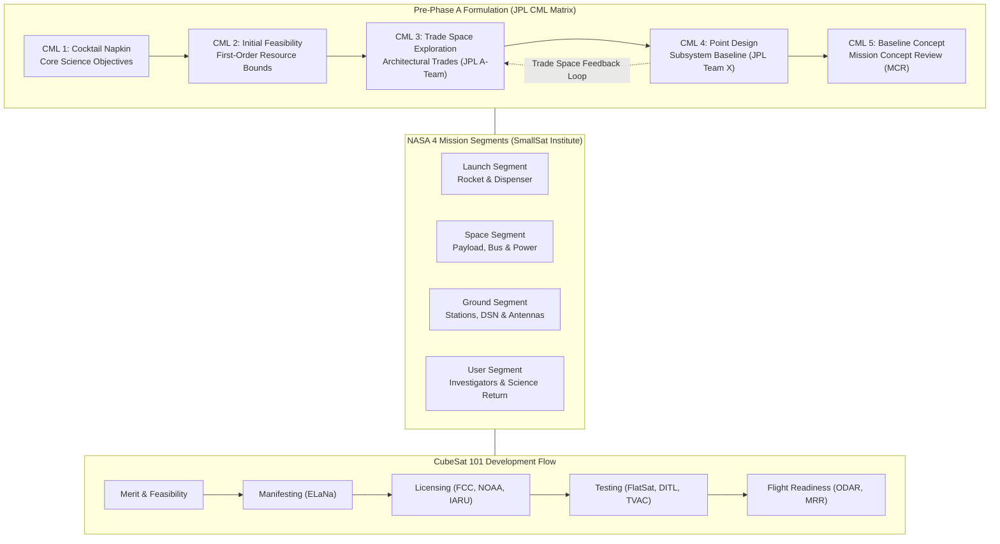

# StellarX | Space Mission Design & Systems Engineering Simulator
### Interactive Educational Trade Space Exploration Inspired by NASA & JPL Systems Engineering Principles

[](https://github.com/Hibah120/StellarX)
[](https://streamlit.io/)
[](https://python.org/)

---

> [!IMPORTANT]
> **Educational Simulation Notice & Disclaimer:**  
> StellarX is an independent educational simulator developed for academic learning and exploration. It is **inspired by space systems engineering concepts** established by NASA and JPL, but is **not certified, sponsored, affiliated with, or endorsed by NASA**.  
> All numerical values in the current version (such as the 220 kg base dry bus mass, rocket payload capacities of 400/500/800 kg, power ratings, arbitrary cost points, and scoring coefficients) are **educational gameplay assumptions** calibrated to provide an engaging and balanced trade space, rather than empirical NASA hardware specifications.  
>  
> *(محاكاة تعليمية مستوحاة من مفاهيم هندسة الأنظمة لدى ناسا، وليست معتمدة أو مؤيدة من ناسا. الأرقام والمعادلات التقييمية افتراضات تعليمية لأغراض اللعبة والمحاكاة).*

---

## 🌌 Overview & Pedagogical Philosophy

StellarX is an interactive educational space mission simulator built with **Python** and **Streamlit**. It introduces students, educators, and space enthusiasts to the fundamentals of **spacecraft systems engineering** and **pre-Phase A mission concept formulation**.

The simulator is conceptually grounded in aerospace methodologies from NASA and JPL:
- **NASA Systems Engineering Handbook (SP-2016-6105)**: Subsystem interdependence, trade studies, and design margins.
- **NASA CubeSat Launch Initiative (CSLI) — CubeSat 101**: 16-phase development lifecycle, P-POD dispenser constraints, and launch readiness reviews.
- **NASA Jet Propulsion Laboratory (JPL / Caltech)**: Pre-Phase A trade space exploration using Concept Maturity Levels (CMLs 1–9).
- **NASA Science "Build It Yourself: Satellite!"**: Pedagogical mechanics linking scientific goals to wavelength selection, instrument compatibility, and real-world heritage analogues.

---

## ⚖️ Systems Engineering Trade-Offs (NASA Conceptual Foundation)

While the numerical values in StellarX are simplified educational assumptions, the **underlying engineering trade-off logic** directly reflects authentic principles documented in NASA technical standards:

1. **Power Subsystem Drives Spacecraft Mass:**
   - As documented in the *NASA Systems Engineering Handbook*, the electrical power subsystem (EPS) encompasses generation (solar arrays, RTGs), energy storage (batteries), and power distribution (PDU). Selecting an instrument with heavy power draw (e.g., Synthetic Aperture Radar) forces the architect to select larger solar wings or nuclear power sources, which directly increases spacecraft dry mass and volume.
2. **Communications Depend on Power, Mass, and Orbit:**
   - Telemetry and science downlink throughput are governed by the RF link budget (Friis transmission equation). Achieving high data rates requires either higher transmitter power, a larger High-Gain directional antenna (increasing mass and requiring pointing mechanisms), or lower orbital altitude.
3. **Engineering Design Margins & Uncertainty:**
   - NASA flight standards require projects to carry mass growth allowances (MGA) and power margins (typically 20% to 30% in early formulation) to absorb uncertainties as the design matures from concept to fabrication. In StellarX, violating these margins triggers engineering conflict flags.

---

## 📐 Mathematical Formulation & Evaluation Scoring

StellarX evaluates mission viability through a set of simplified, transparent mathematical equations:

### 1. Spacecraft Mass & Launcher Capacity Margin
The total mass of the spacecraft combines the base dry bus with the selected subsystems:

$$\text{Total Mass} = M_{\text{bus}} + M_{\text{instrument}} + M_{\text{power}} + M_{\text{antenna}}$$

Where $M_{\text{bus}} = 220\text{ kg}$ (educational assumption for primary structure, avionics, attitude control, and thermal control).  
**Constraint:** $\text{Total Mass} \le \text{Rocket Payload Capacity}$ (400 kg for Small, 500 kg for Medium, 800 kg for Heavy).

### 2. Mission Cost & Budget Efficiency
Costs are modeled in normalized simulation points:

$$\text{Total Cost} = C_{\text{base}} + C_{\text{rocket}} + C_{\text{instrument}} + C_{\text{power}} + C_{\text{antenna}} + C_{\text{orbit}}$$

Where $C_{\text{base}} = 10\text{ points}$.  
**Constraint:** $\text{Total Cost} \le \text{Available Budget}$ (user-configured between 50 and 150 points).  
$$\text{Budget Efficiency } (B_e) = \max\left(0, 100 - \left(\frac{\text{Total Cost}}{\text{Budget}} \times 20\right)\right)$$

### 3. Electrical Power Balance
The total power required by active spacecraft subsystems:

$$\text{Power Demand} = P_{\text{avionics}} + P_{\text{instrument}} + P_{\text{antenna}}$$

Where $P_{\text{avionics}} = 10\text{ W}$ (base house-keeping power).  
**Constraint:** $\text{Power Demand} \le \text{Power Supply}$  
$$\text{Power Adequacy Ratio } (P_r) = \min\left(100, \frac{\text{Power Supply}}{\text{Power Demand}} \times 100\right)$$

### 4. Data Downlink & Communications Capacity
Effective downlink throughput depends on the antenna hardware and orbital geometry:

$$\text{Effective Downlink} = \text{Antenna Capacity} \times f_{\text{orbit}}$$

**Constraint:** $\text{Data Generated} \le \text{Effective Downlink}$  
$$\text{Comms Adequacy Ratio } (K_r) = \min\left(100, \frac{\text{Effective Downlink}}{\text{Data Generated}} \times 100\right)$$

### 5. Composite Mission Performance Score
The overall mission rating is calculated using a multi-objective weighted utility formula:

$$\text{Mission Score} = (0.35 \times S) + (0.25 \times C) + (0.15 \times P_r) + (0.15 \times K_r) + (0.10 \times B_e) - (10 \times N_{\text{conflicts}})$$

Where:
- $S$: Scientific Value (+10 bonus points if the chosen instrument matches the mission objective).
- $C$: Planetary Surface Coverage percentage (60% to 100%).
- $P_r$: Power Adequacy Ratio (%).
- $K_r$: Communication Link Adequacy Ratio (%).
- $B_e$: Budget Efficiency Score (%).
- $N_{\text{conflicts}}$: Number of critical engineering violations (mass overload, budget deficit, power shortfall, comms bottleneck, or inadequate coverage).

---

## 🎯 Component Catalog & Educational Gameplay Assumptions

The parameters below are **educational approximations** calibrated for gameplay balance and trade space exploration:

| Subsystem | Component | Cost (Pts) | Mass (kg) | Power Draw / Supply (W) | Data / Capacity | Science Value | Educational Design Notes |
|:---|:---|:---:|:---:|:---:|:---:|:---:|:---|
| **Launch** | Small Rocket | 20 | — | — | Cap: 400 kg | — | Low cost, restricted to lightweight payloads |
| **Launch** | Medium Rocket | 35 | — | — | Cap: 500 kg | — | Balanced payload capacity for standard science |
| **Launch** | Heavy Rocket | 50 | — | — | Cap: 800 kg | — | Heavy lifter for deep space or multi-payloads |
| **Space** | Radar | 30 | 120 | -65 W | 40 Mbps | 80 | High science, high power/data consumption |
| **Space** | Optical Camera | 20 | 60 | -35 W | 20 Mbps | 65 | Lightweight, low resource demand |
| **Space** | Spectrometer | 25 | 75 | -45 W | 25 Mbps | 75 | Detailed chemical/composition analysis |
| **Space** | Basic Solar Panels | 15 | 80 | +85 W | — | — | Standard dual-wing photovoltaic array |
| **Space** | Advanced Solar Panels | 25 | 110 | +115 W | — | — | High-efficiency multi-junction cells |
| **Space** | Nuclear Power Unit | 35 | 120 | +140 W | — | — | Continuous RTG power, independent of sunlight |
| **Ground** | Standard Antenna | 5 | 20 | -5 W | 45 Mbps | — | Omnidirectional whip antenna |
| **Ground** | High-Gain Antenna | 15 | 35 | -10 W | 80 Mbps | — | Parabolic reflector dish for high throughput |
| **Orbit** | Low Orbit (LEO) | 0 | — | — | Factor: 0.90 | Cov: 85% | ~400 km; frequent ground station passes |
| **Orbit** | Polar Orbit | 10 | — | — | Factor: 0.85 | Cov: 100% | ~700 km; full global surface planetary coverage |
| **Orbit** | High Orbit (GEO) | 15 | — | — | Factor: 1.40 | Cov: 60% | ~35,786 km; continuous line-of-sight communication |

*Base Spacecraft Bus: Mass = 220 kg | Base Cost = 10 pts | Base Avionics Power = 10 W*

---

## 🛰️ Orbital Regimes Clarification

StellarX models three distinct orbital environments based on classical orbital mechanics:

1. **Low Earth Orbit (LEO — ~400 km circular):**
   - Low launch delta-V requirement and high spatial ground resolution. The orbital period is ~90 minutes, resulting in short, periodic communication windows with ground stations.
2. **Polar Orbit (~700 km Sun-Synchronous):**
   - High inclination orbit passing over polar regions. As the planet rotates beneath the orbital plane, the satellite achieves complete **100% global surface coverage** over repetitive ground tracks.
3. **Geostationary Earth Orbit (GEO — ~35,786 km circular):**
   - High equatorial orbit whose orbital period matches the planet's rotation rate (~24 hours). The spacecraft remains fixed over one terrestrial meridian, providing continuous line-of-sight communication with fixed hemispheric coverage (~60% planetary surface).
   - *Note on Lagrange Points:* Lagrange points (L1, L2, etc.) are gravitational equilibrium points in three-body systems (such as the Sun-Earth L2 point at ~1.5 million km where JWST operates), and are physically distinct from Earth-centered Geostationary Orbits (GEO).

---

## 🏛️ Systems Engineering Alignment (NASA & JPL Frameworks)



### 1. JPL Concept Maturity Levels (CML 1–9)
*(Reference: Wessen, Borden, Ziemer, Kwok — Jet Propulsion Laboratory / Caltech)*
- **CML 1 (Cocktail Napkin):** Formulation of fundamental scientific questions.
- **CML 2 (Initial Feasibility):** First-order estimation of mass, power, communication, and cost.
- **CML 3 (Trade Space Exploration):** Multi-disciplinary trade studies evaluating alternative configurations (led at JPL by the **A-Team**).
- **CML 4 (Point Design):** Selecting a viable, converged point design with verified design margins (led at JPL by **Team X**).
- **Iterative CML 2–4 Loop:** When a conflict occurs in Point Design (e.g., mass overload or power deficit), engineers loop back to Trade Space Exploration (CML 3) to test alternative configurations. StellarX simulates this exact iterative feedback loop.

### 2. The 4 Mission Segments
*(Reference: NASA Systems Engineering Handbook & NASA SmallSat Institute, Julie Levri)*
1. **Launch Segment:** Launch vehicles, fairing envelope, and orbital delivery.
2. **Space Segment:** Spacecraft bus structure, science instruments, and power systems.
3. **Ground / Comms Segment:** Antennas, tracking ground stations, Deep Space Network (DSN), and mission operations.
4. **User Segment:** The scientific and research community receiving downlinked data products (*"Begin with the End in Mind"*).

### 3. CubeSat 101 & Mission Lifecycle (Educational Context)
*(Reference: NASA CubeSat Launch Initiative — Basic Concepts & Processes for Developers)*
- Demonstrates how auxiliary payloads progress through standardized reviews, testing (FlatSat, DITL, TVAC bakeout), regulatory licensing (FCC, NOAA remote sensing, IARU frequency coordination), and safety documentation (ODAR debris mitigation).

### 4. Real-World Heritage Mission Analogues
*(Pedagogical mapping inspired by NASA's "Build It Yourself: Satellite!")*
- **Radar + Planetary Mapping:** NASA SMAP & Magellan (active microwave radar).
- **Camera + Area Photography:** BisonSat & Lunar Reconnaissance Orbiter (LRO).
- **Spectrometer + Composition:** MinXSS & Dellingr (solar physics & spectrometry).
- **Multi-Sensor Platforms:** Dawn & Mars Reconnaissance Orbiter (MRO).

---

## 🚀 Getting Started

### Prerequisites
- Python 3.9+
- Pip package manager

### Installation
```bash
git clone https://github.com/Hibah120/StellarX.git
cd StellarX
pip install -r requirements.txt
```

### Running the Simulator
```bash
streamlit run app.py
```
Open your browser at `http://localhost:8501`.

---

## 📂 Project Structure
```
StellarX/
├── app.py              # Main Streamlit application with interactive simulator, SVG blueprint & SE tabs
├── requirements.txt    # Application dependencies (streamlit, pandas, altair)
└── README.md           # Master systems engineering & pedagogical documentation
```

---

## 📚 References & Conceptual Citations
1. **NASA CubeSat Launch Initiative (CSLI)** — *CubeSat 101: Basic Concepts and Processes for First-Time CubeSat Developers* (Doc ID: `NP-2017-10-2470-HQ`).
2. **NASA Jet Propulsion Laboratory (JPL / Caltech)** — *Space Mission Concept Development Using Concept Maturity Levels (CMLs)* (Wessen, Borden, Ziemer, Kwok).
3. **NASA SmallSat Institute & Science Mission Directorate (SMD)** — *Design and Develop Science Missions* (Julie Levri, Systems Engineering Series).
4. **NASA Goddard Space Flight Center (GSFC)** — *Mission Design Lab (MDL) Concurrent Engineering Guidelines*.
5. **NASA SP-2016-6105** — *NASA Systems Engineering Handbook*.
6. **NASA Science** — *Build It Yourself: Satellite!* and *Scope It Out* Educational Simulations.
